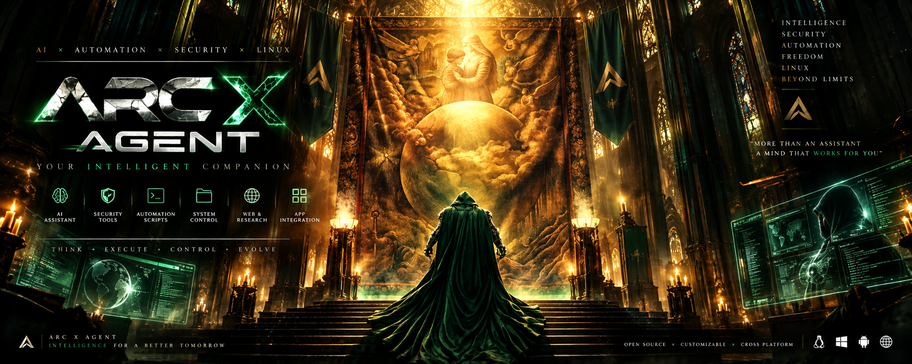
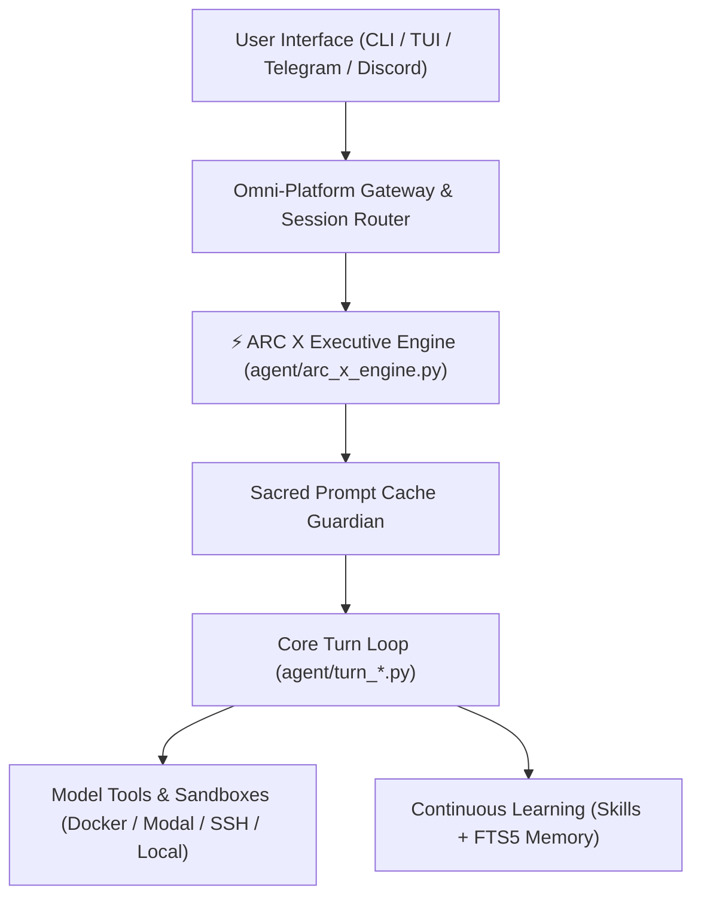

<p align="center">
  
</p>

# ARC X AGENT ⚡

```text
 █████╗ ██████╗  ██████╗  ██╗  ██╗   █████╗  ██████╗ ███████╗███╗   ██╗████████╗
██╔══██╗██╔══██╗██╔════╝  ╚██╗██╔╝  ██╔══██╗██╔════╝ ██╔════╝████╗  ██║╚══██╔══╝
███████║██████╔╝██║        ╚███╔╝   ███████║██║  ███╗█████╗  ██╔██╗ ██║   ██║   
██╔══██║██╔══██╗██║        ██╔██╗   ██╔══██║██║   ██║██╔══╝  ██║╚██╗██║   ██║   
██║  ██║██║  ██║╚██████╗  ██╔╝ ██╗  ██║  ██║╚██████╔╝███████╗██║ ╚████║   ██║   
╚═╝  ╚═╝╚═╝  ╚═╝ ╚═════╝  ╚═╝  ╚═╝  ╚═╝  ╚═╝ ╚═════╝ ╚══════╝╚═╝  ╚═══╝   ╚═╝   
```

<p align="center">
  <a href="#quick-start">Quick Start</a> •
  <a href="#architecture--enhancements">Enhancements</a> •
  <a href="#heritage--credits">Hermes Heritage</a> •
  <a href="#command-reference">Commands</a> •
  <a href="#configuration">Configuration</a>
</p>

<p align="center">
  
  
  
  
  
</p>

---

## What is ARC X AGENT?

**ARC X AGENT** is an autonomous executive AI agent engineered for deep multi-turn problem solving, tool orchestration, and cross-platform continuous operations. 

> [!IMPORTANT]
> **Hermes Agent Heritage**: ARC X AGENT is built upon and powered by the open-source agent architecture of **[Hermes Agent](https://github.com/NousResearch/hermes-agent)** created by **[Nous Research](https://nousresearch.com)**. It inherits Hermes's sacred prompt-caching invariants, narrow-waist core loop, multi-platform messaging gateway, and self-improving memory/skills architecture, while infusing the custom **ARC X Executive Engine**, high-tech terminal aesthetics, and optimized command runners.

---

## Key Capabilities

| Capability | Description |
| :--- | :--- |
| **⚡ Executive Core** | Autonomous task execution with prompt cache protection, invariant checking, and zero external telemetry. |
| **🧠 Closed Learning Loop** | Self-improving skills creation, persistent procedural memory, session search with LLM summarization, and Honcho user modeling. |
| **🌐 Omni-Platform Gateway** | Run locally in your terminal or bridge to Telegram, Discord, Slack, WhatsApp, Signal, and Matrix via a unified gateway. |
| **🔒 Sandboxed Execution** | Seven execution backends: local shell, Docker, SSH, Singularity, Modal, Daytona, and Vercel Sandbox. |
| **🛠️ 40+ Integrated Tools** | File operations, terminal execution, live web search, browser automation (CDP), media generation, and full MCP server integration. |
| **⚡ Sacred Prompt Caching** | Architectural guarantee preserving provider prompt cache across turns, drastically lowering inference latency and costs. |

---

## Quick Start

### 1. Automated Installation

Run the unified ARC X installer:

```bash
# Clone the repository
git clone https://github.com/Arunachalam-gojosaturo/ARCXAGENT.git
cd ARCXAGENT

# Run the automated installer
bash scripts/install_arc_x.sh
```

The installer verifies your platform, provisions isolated runtime tools (`uv`, `node`, `npm`, `ripgrep`, `ffmpeg`), builds dependencies, and links `arc-x`, `arcx`, and `arcxagent` into your local path.

### 2. Reload Shell Environment

```bash
source ~/.bashrc  # Or ~/.zshrc if using zsh
```

### 3. Launch ARC X AGENT

```bash
# Interactive REPL / TUI mode
arc-x

# Or use the quick alias
arcx

# One-shot command execution
arc-x -z "Analyze git commits from today and summarize progress"

# Check system status
arc-x status
```

---

## Architecture & Enhancements

ARC X AGENT extends Hermes Agent with specialized executive capabilities:



### Enhancements Introduced in ARC X AGENT:
1. **ARC X Executive Guard (`agent/arc_x_engine.py`)**: Real-time validation preventing mid-session prompt mutations, preserving token cache integrity, and verifying zero telemetry leaks.
2. **Dedicated CLI Launcher Suite**: Native symlink-resolving binaries (`bin/arc-x`, `bin/arcx`, `bin/arcxagent`) registered in `pyproject.toml`.
3. **Electric Terminal Theme**: Custom `"arc-x"` visual identity, response framing (`╭─ ⚡ ARC X ─────────╮`), status bar, and banner art.
4. **Autonomous Skill Integration**: Includes specialized executive workflow skills in `skills/productivity/arc-x-executive/`.
5. **Full Backwards Compatibility**: Legacy commands (`hermes`, `hermes model`, `hermes setup`) continue to operate without interference.

---

## Command Reference

| Command | Action |
| :--- | :--- |
| `arc-x` or `arcx` | Start interactive conversational agent |
| `arc-x -z "<prompt>"` | One-shot mode: runs task and outputs final result directly |
| `arc-x setup` | Run interactive configuration wizard |
| `arc-x model` | Select and switch LLM provider and default model |
| `arc-x tools` | Enable, configure, and inspect toolsets |
| `arc-x status` | Show active model, provider, and gateway status |
| `arc-x config` | View configuration files, paths, and settings |
| `arc-x gateway` | Start background messaging gateway |
| `arc-x logs` | View and follow real-time agent execution logs |
| `arc-x doctor` | Run comprehensive health and environment diagnostic |

---

## Configuration & Providers

ARC X AGENT supports any standard LLM provider:

```bash
# Configure with wizard
arc-x setup

# Or set custom provider directly
arc-x config set model.provider custom
arc-x config set model.base_url http://localhost:11434/v1
arc-x config set model.default mistral
```

Supported providers:
- **Google AI Studio (Gemini)**
- **OpenRouter** (300+ models)
- **Anthropic (Claude)**
- **OpenAI (GPT-4o, o3-mini)**
- **Nous Portal**
- **Local Endpoints** (Ollama, llama.cpp, vLLM, LM Studio)

---

## Heritage & Credits

ARC X AGENT is built upon the monumental foundation of **Hermes Agent**:
- **Upstream Project**: [NousResearch/hermes-agent](https://github.com/NousResearch/hermes-agent)
- **Original Architecture**: Nous Research Team
- **Core Design Principles**: Narrow waist core, edge capabilities, sacred prompt caching, and open agent skills standard ([agentskills.io](https://agentskills.io)).

All respect and credit to the Nous Research team and the open-source contributors who built the foundational Hermes agent runtime.

---

## License

This project is licensed under the **MIT License** — see the [LICENSE](LICENSE) file for details.
